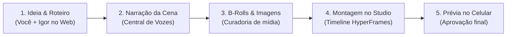

# 🎬 Bem-vindo ao Vincere Studio — Guia de Colaboração & Produção

> **Bem-vindo à equipe!** Este documento é o seu ponto de partida para colaborar com o Igor na criação, direção e edição de vídeos de alto impacto no **Vincere Studio**.

---

## 🌐 1. Acesso Imediato à Plataforma (24/7 na Nuvem)

Você pode acessar o Vincere Studio pelo computador, tablet ou celular de qualquer lugar:

* **Endereço Web:** [http://143.95.167.129:3210](http://143.95.167.129:3210)
* **PIN de Acesso Seguro:** `22897479`

> Ao entrar pela primeira vez, digite o PIN acima. O sistema registrará seu acesso com segurança por 90 dias, sem você precisar digitar novamente.

---

## 🎯 2. O Que É o Vincere Studio?

O **Vincere Studio** é uma estação de trabalho audiovisual completa desenvolvida para criar vídeos cinematográficos, documentários investigativos, cortes dinâmicos e comerciais com inteligência artificial e código aberto:

* **Copiloto Criativo:** Geração de roteiros estruturados em blocos de tempo ("beats" de 5 a 15 segundos);
* **Central de Vozes:** Síntese de narração neural e clonagem de voz ultra-realista;
* **Curadoria de Mídia:** Busca de B-rolls históricos de arquivo e geração de cenas hiper-realistas com Google Flow e Veo 3.1;
* **HyperFrames Studio:** Motor de edição com hot-reload instantâneo e renderização acelerada por GPU a 60fps;
* **Legendas Dinâmicas (Lockup):** Tipografia cinética onde palavras de apoio se encaixam geometricamente nos vãos das palavras principais, com efeito de brilho e sem poluição visual.

---

## 👟 3. O Projeto Ativo: "Como a Nike Nasceu de Uma Ideia Improvável"

Nosso foco de produção atual é o vídeo sobre a fundação da Nike (baseado no livro *Shoe Dog* de Phil Knight e relatórios históricos).

### A Identidade Visual do Projeto:
* **Formato:** Vertical (9:16 — Reels, TikTok, Shorts);
* **Estilo de Narrativa:** Dossiê investigativo de arquivo — iluminação contrastada, texturas de papel antigo, carimbos, fotos raras e recortes de jornal;
* **Estilo de Legenda:** `dossie_mono` (fonte monoespaçada com acento vermelho em palavras-chave e caixas de texto limpas);
* **Cadência:** Dinâmica e envolvente, com quebras de padrão e ganchos de retenção a cada 3 a 5 segundos.

---

## 🤝 4. Como Vamos Trabalhar em Dupla

Aqui está o fluxo de trabalho para colaborarmos de forma rápida e alinhada:

### O Que Você Pode Fazer no Sistema Agora:

1. **Revisar Roteiros & Ganchos (`/projects` e `/copilot`):**
   - Acesse o projeto da Nike e avalie a força da frase de abertura (os primeiros 3 segundos decidem se o espectador continua assistindo).
   - Sugira novos blocos dramáticos ou fatos curiosos para enriquecer a narrativa.

2. **Explorar Tendências de Conteúdo (`/tendencias`):**
   - Veja as análises de mercado em tempo real geradas com dados reais de visualizações do YouTube e oportunidades de nicho (em português, espanhol e inglês) para planejarmos os próximos vídeos.

3. **Avaliar e Aprovar Prévias no Celular (`/studio`):**
   - Na aba do estúdio, temos a gaveta **"Prévias para aprovar"**. Você pode dar o play no corte atual, avaliar a trilha sonora, efeitos sonoros (SFX) e o ritmo das legendas, deixando seu feedback direto para refinamento.

4. **Conversar com o Assistente Vince:**
   - No canto inferior direito da tela, temos o **Vince**. Você pode pedir ideias, consultar informações sobre qualquer cena ou enviar comandos de direção diretamente.

---

## 📐 5. As Regras de Ouro da Nossa Produção

Para mantermos o padrão cinematográfico, seguimos 3 mandamentos:

1. **A Narração Manda no Tempo:** Sempre sintetizamos o áudio da locução antes de montar a timeline. A respiração e o ritmo da voz cravam a duração exata de cada corte na tela.
2. **Fato Real pede Imagem Real:** Sempre que o roteiro citar pessoas reais, datas e documentos de época, usamos acervos históricos reais em vez de imagens genéricas de IA.
3. **Retenção sem Fadiga:** Legendas em destaque tipo lockup, transições na batida e trilha de fundo sutil para nunca sobrepor a voz principal.

---

## 🚀 Próximo Passo:

Abra o link **[http://143.95.167.129:3210](http://143.95.167.129:3210)**, digite o PIN `22897479` e explore o painel! Quando terminar a navegação, me avise o que achou do projeto da Nike para definirmos os ajustes da versão final!
