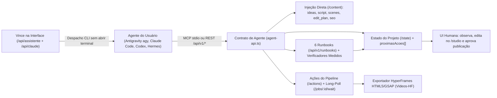
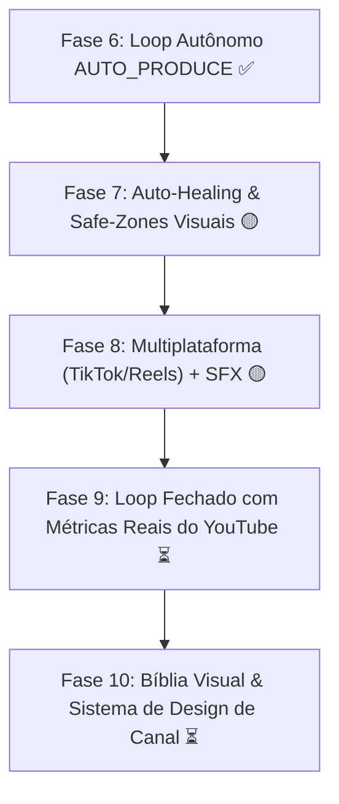

# Roadmap — Vincere Studio "Agente-Primeiro" (Fases 0 a 6 Concluídas • Fases 7 a 10 em Andamento)

Meta: o agente de IA (**Antigravity `agy`**, **Claude Code**, **Codex**, **Hermes**) é quem **conduz** todo o processo de criação de ponta a ponta. O **Vincere Studio** atua como **caixa de ferramentas + memória + verificador + palco visual (HyperFrames)**, enquanto o **Vince** na interface serve como ponte direta para disparar execuções de terminal e fluxos no agente sem precisar abrir o terminal.

---

## Status de Execução do Roadmap

- [x] **Decisão 1 — Motor Visual Único**: Mantido exclusivamente o **HyperFrames** (componentes e rotas órfãs do Remotion Studio removidos; skills e Plano de Edição unificados no HyperFrames Studio).
- [x] **Decisão 2 — Papel do Vince**: Mantido como assistente flutuante ativo e contextual, ponte de execução de terminal via agente externo (`agy`, `claude`, `codex`, `hermes`) e executor de ações nativas no projeto via contrato `/api/v1/*`.
- [x] **Decisão 3 — Cérebro Híbrido (Agente Livre + LLM Interno Opcional)**: O agente pode injetar conteúdo autoral direto (`POST /api/v1/projects/[id]/content`) ou acionar os geradores internos (`POST /api/v1/projects/[id]/actions`).
- [x] **Decisão 4 — REST `/api/v1/*` + Servidor MCP Nativo**: Implementada a camada REST `/api/v1/*` completa e o servidor MCP oficial em `scripts/vincere-mcp-server.mjs` (`pnpm mcp:server`).
- [x] **Fase 0 — Limpeza, Unificação em HyperFrames e Higiene de Rotas** (Concluída)
- [x] **Fase 1 — Contrato de Agente `/api/v1/*` + Gates no Servidor** (Concluída)
- [x] **Fase 2 — O Agente como Cérebro (Injeção Direta de Conteúdo & Workflows)** (Concluída)
- [x] **Fase 3 — Runbooks Executáveis & Verificadores Medidos** (Concluída)
- [x] **Fase 4 — Manifesto de Capacidades, Servidor MCP & Vince Integrado** (Concluída)
- [x] **Fase 5 — Validação Ponta a Ponta (Typecheck, Testes Unitários e E2E ao Vivo)** (Concluída)
- [x] **Fase 6 — Automação Contínua & Loop de Produção Autônomo (`AUTO_PRODUCE`)** (Concluída)
- [ ] **Fase 7 — Auto-Healing & Safe-Zones Visuais** (Parcial: 7.1 e 7.2 Concluídos, 7.3 Pendente)
- [ ] **Fase 8 — Multiplataforma (Reels & TikTok) e Sonorização Dinâmica (SFX)** (Parcial: 8.1 Concluído, 8.2 e 8.3 Pendentes)
- [ ] **Fase 9 — Calibração por Aprendizado com Dados Reais do YouTube** (Pendente)
- [ ] **Fase 10 — Bíblia Visual & Sistema de Design por Canal** (Pendente)

---

## 1. Diagnóstico Inicial vs. Solução Implementada

| # | Problema Diagnosticado | Solução Implementada (Status: ✅ Feito) |
|---|---|---|
| 1 | Pipeline preso em ~60 *server actions* de formulários Next.js. | Criada camada de serviços em `apps/web/lib/agent-api.ts` e exposta em `POST /api/v1/projects/[id]/actions`. |
| 2 | API pública era quase só leitura; agente não via o estado do projeto. | Criados `GET /api/v1/projects`, `GET /api/v1/projects/[id]` e `GET /api/v1/projects/[id]/state` com `etapasConcluidas`, `metricas`, `pendencias[]` e `proximasAcoes[]`. |
| 3 | `POST /api/jobs` não validava pré-condições nem travas de aprovação. | `POST /api/v1/projects/[id]/actions` valida pré-condições com Zod, garante idempotência e bloqueia `publicar_youtube` sem render aprovado (`403 GATE_APROVACAO_OBRIGATORIO`). |
| 4 | Todo texto criativo dependia de um LLM interno (`TEXT_PROVIDER`). | Criado `POST /api/v1/projects/[id]/content` para o próprio agente enviar `ideas`, `script` (em atos), `scenes`, `edit_plan` e `seo`. |
| 5 | `/workflow` só podia ser editado manualmente no canvas. | Criados `GET / POST /api/v1/workflows` e `GET / PUT / POST /api/v1/workflows/[id]` com validação topológica (`canConnect`). |
| 6 | Skills eram apenas texto descritivo sem verificação. | Criado `apps/web/lib/runbooks.ts` + `/api/v1/runbooks` com 6 Runbooks executáveis e verificadores medidos no banco e no disco. |
| 7 | Sem contrato legível por máquina nem MCP. | Criados `GET /api/v1/capabilities` e o servidor MCP `scripts/vincere-mcp-server.mjs` (`pnpm mcp:server`) com 10 ferramentas `vincere_*`. |
| 8 | Espera de jobs exigia loop manual de polling. | Criado `GET /api/v1/jobs/[id]/wait?timeoutMs=25000` (long-polling inteligente que devolve o resultado parseado). |
| 9 | Duplicidade entre Remotion Studio e HyperFrames Studio. | Removidos arquivos órfãos do Remotion Studio (`OpenRemotionStudio.tsx`, `remotion-studio.ts`, rotas) e adicionado exportador direto HTML5/GSAP (`exportar_hyperframes`). |
| 10 | Página `/docs` em inglês/desatualizada e `/history` duplicada. | `/docs` transformada na **Central Agente-Primeiro & Documentação** e `/history` unificada em `/projects?modo=todos`. |

---

## 2. Arquitetura Implementada

---

## 3. Entregas por Fase (Todas Concluídas)

### ✅ Fase 0 — Limpeza, Unificação em HyperFrames e Higiene de Rotas
- [x] Removidos `apps/web/components/OpenRemotionStudio.tsx`, `apps/web/lib/remotion-studio.ts`, `apps/web/app/api/remotion-studio/route.ts` e `apps/web/app/api/projects/[id]/remotion-props/route.ts`.
- [x] Migradas todas as skills do catálogo (`apps/web/lib/skills-catalog.ts` e `SystemSkillsCatalog.tsx`) e o Plano de Edição (`projects/[id]/edit-plan/page.tsx`) para **HyperFrames**.
- [x] Removido `enqueueDemoJob` de `apps/web/app/(studio)/settings/actions.ts` e `settings/page.tsx`.
- [x] Reescrita `apps/web/app/(studio)/docs/page.tsx` como **Central Agente-Primeiro & Documentação**.
- [x] Consolidada `apps/web/app/(studio)/history/page.tsx` redirecionando para `/projects?modo=todos`.
- [x] Centralizados `pastaReelsTools()` e `pastaSharingan()` em `apps/web/lib/pastas.ts`.

### ✅ Fase 1 — Contrato de Agente: `/api/v1/*` + Gates no Servidor
- [x] `apps/web/lib/agent-api.ts`:
  - `checkAgentAuth(req)`: acesso livre em `localhost` ou via `Authorization: Bearer <VINCERE_AGENT_TOKEN>`.
  - `computeProjectAgentState(projectId)`: diagnóstico completo de etapas, métricas, pendências e `proximasAcoes[]`.
  - `enqueueProjectJob(projectId, type, payload, opts)`: enfileiramento idempotente.
  - `exportProjectToHyperFrames(projectId)`: gera composição HTML5/GSAP real (`index.html` + `vincere-manifest.json`) em `Videos-HF/<slug>/`.
- [x] `apps/web/app/api/v1/projects/route.ts` (`GET`, `POST`).
- [x] `apps/web/app/api/v1/projects/[id]/route.ts` (`GET`, `PATCH`, `DELETE` com confirmação obrigatória).
- [x] `apps/web/app/api/v1/projects/[id]/state/route.ts` (`GET`).
- [x] `apps/web/app/api/v1/projects/[id]/actions/route.ts` (`POST` para todas as 18 ações do pipeline, incluindo trava `403 GATE_APROVACAO_OBRIGATORIO` em `publicar_youtube`).
- [x] `apps/web/app/api/v1/jobs/[id]/wait/route.ts` (`GET` com long-polling configurável).

### ✅ Fase 2 — O Agente como Cérebro (Injeção Direta de Conteúdo & Workflows)
- [x] `apps/web/app/api/v1/projects/[id]/content/route.ts` (`POST`):
  - `kind: "ideas"`, `kind: "script"`, `kind: "scenes"`, `kind: "edit_plan"` e `kind: "seo"`.
- [x] `apps/web/app/api/v1/workflows/route.ts` (`GET`, `POST`) e `apps/web/app/api/v1/workflows/[id]/route.ts` (`GET`, `PUT`, `POST`).

### ✅ Fase 3 — Runbooks Executáveis & Verificadores Medidos
- [x] `apps/web/lib/runbooks.ts` + `apps/web/app/api/v1/runbooks/route.ts`:
  - `curiosidades-short-9x16`
  - `dossie-documentario-16x9`
  - `hyperframes-motion-pure`
  - `clone-motion-sharingan`
  - `talking-head-cortes`
  - `ugc-comercial-workflow`
- [x] `evaluateRunbookForProject(runbookId, projectId)` medindo cada passo contra o estado real do projeto e arquivos em disco.

### ✅ Fase 4 — Manifesto de Capacidades, Servidor MCP & Vince
- [x] `apps/web/app/api/v1/capabilities/route.ts` (`GET`): manifesto completo da instância.
- [x] `scripts/vincere-mcp-server.mjs` (`pnpm mcp:server`): servidor MCP JSON-RPC 2.0 sobre `stdio` com 10 ferramentas `vincere_*`.
- [x] `apps/web/lib/vince-sistema.ts` e `apps/web/public/AGENTES.md` atualizados com o contrato `/api/v1/*`, Runbooks e execução via terminal.

### ✅ Fase 5 — Validação Ponta a Ponta
- [x] `pnpm typecheck`: aprovado sem erros em todos os 7 pacotes.
- [x] `pnpm --filter @vincere-studio/web test:unit`: **67/67 testes aprovados** (7 suítes, incluindo `apps/web/lib/runbooks.test.ts`).
- [x] Bateria E2E ao vivo contra `http://localhost:3210`:
  - `GET /api/v1/capabilities` (`worker.online: true`, 6 runbooks, `visualEngine: "HyperFrames"`).
  - Criação de projeto → injeção direta de ideias, roteiro, cenas, plano de edição e SEO → avaliação de Runbook → síntese de voz real no Worker (`sintetizar_voz` + `/api/v1/jobs/[id]/wait` concluída com `DONE`) → exportação HyperFrames (`index.html` gerado) → bloqueio `403 GATE_APROVACAO_OBRIGATORIO` sem aprovação → criação e validação de Workflow UGC → chamadas JSON-RPC ao Servidor MCP → **21/21 rotas da interface com HTTP 200 OK**.

---

## 4. Próximas Fases Planejadas (Ciclo de Expansão e Escala)

### ✅ Fase 6 — Automação Contínua & Loop de Produção Autônomo (`AUTO_PRODUCE`) (Concluída)
- [x] **Ação Unificada `auto_produce`**: Um comando único via MCP ou `/api/v1/projects/[id]/actions` (`action: "auto_produce"`) que orquestra todo o ciclo do vídeo (ideação -> roteiro -> narração -> legendas -> cenas IA/B-roll -> HyperFrames -> render de prova) sem intervenção humana no meio (`apps/worker/src/jobs/auto-produce.ts`).
- [x] **Garantia Inviolável de Gate Humano**: O loop para estritamente na aprovação do render (`403 GATE_APROVACAO_OBRIGATORIO`). Nenhuma publicação ocorre de forma automática sem o OK do editor humano no servidor.
- [x] **Webhooks de Notificação Instantânea**: Disparo de payload configurável (`WEBHOOK_URL`) com preview e link de aprovação assim que o render for concluído no worker.

### 🟡 Fase 7 — Auto-Healing & Auditoria Visual de Safe-Zones (Parcial)
- [x] **7.1 — Recuperação de Falhas em Camadas (Auto-Healing)**: Se a síntese de voz ou busca de acervo oscilar ou atingir limites de taxa, o worker chaveia automaticamente para provedores secundários resilientes (inserção automática de `EDGE_TTS` no `apps/worker/src/jobs/synthesize-voice.ts` e cascata de motores grátis no `generate-images.ts`) sem interromper o fluxo global.
- [x] **7.2 — Verificação de Safe-Zones para Formato Vertical (`9:16`)**: Auditoria automatizada (`packages/core/src/safe-zones.ts` e `safe-zones.test.ts`) para impedir que legendas, lower-thirds e elementos gráficos caiam nas áreas cobertas pela interface nativa do TikTok, Instagram Reels e YouTube Shorts (zona inferior e lateral direita), com integração direta no `apps/worker/src/jobs/render-video.ts`.
- [ ] **7.3 — Detecção Perceptual de Imagens Parecidas (pHash / dHash)**:
  - Comparação de distância de Hamming entre hashes perceptuais (dHash 64-bit / pHash) de cenas consecutivas geradas por IA ou acervo.
  - Alerta automático ou regeneração com novo enquadramento caso a similaridade visual ultrapasse 85%, prevenindo planos repetitivos ou estáticos.
  - Verificação integrada na validação do Runbook e no job `GENERATE_IMAGES` do worker.

### 🟡 Fase 8 — Multiplataforma (Reels & TikTok) e Sonorização Dinâmica (SFX) (Em Andamento)
- [x] **8.1 — Biblioteca de Efeitos Sonoros Procedurais em FFmpeg**: Ingestão de whooshes, risers, swooshes e impactos sonoros via síntese direta de áudio sem dependência externa, royalties ou risco de direitos autorais (`packages/render/src/sfx.ts`).
- [ ] **8.2 — Conexão OAuth com TikTok & Meta Graph API (Instagram Reels)**:
  - Painel de conexões em `/settings` ("Canais e Redes Conectadas") gerenciando tokens com auto-refresh para TikTok Content Posting API e Instagram Graph API.
  - Ação `publicar_multiplataforma` no pipeline com validação estrita de pré-condições (render aprovado, safe-zones OK, proporção 9:16).
  - Agendamento de postagens e sincronização de thumbnails personalizadas para cada rede.
- [ ] **8.3 — Sonorização Dinâmica Sincronizada com Legendas Lockup e Cortes**:
  - Motor em `packages/render/src/sfx-sync.ts` que analisa os timestamps de transição de cena e palavras-chave de impacto marcadas nas legendas Lockup (geradas pelo `/subtitles-studio`).
  - Posicionamento milimétrico de SFX procedurais (`whoosh` em cortes de cena, `impact` em números/palavras de choque, `riser` no fim de ganchos).
  - Mixagem de áudio em FFmpeg com sidechain ducking automático (reduzindo a música de fundo em 4 dB durante falas e batidas de efeito).

### ⏳ Fase 9 — Calibração por Aprendizado com Dados Reais do YouTube
- [ ] **9.1 — Ingestão de Retenção do YouTube Analytics API v3**:
  - Endpoint `GET /api/v1/analytics/youtube` e job de sincronização periódica de métricas reais (curva de retenção segundo a segundo, taxa de retenção aos 30s e CTR de thumbnail).
  - Visualização gráfica comparativa no `/projects/[id]` sobrepondo a retenção real sobre os atos do roteiro e os cortes de cena.
- [ ] **9.2 — Retroalimentação do Roteiro e Aprendizado Ativo do Vince**:
  - Vince correlaciona automaticamente os pontos de fuga da audiência (quedas > 15% na retenção) com o tipo de cena, velocidade da fala (PPM) ou ausência de estímulo visual.
  - As conclusões alimentam as regras do nicho e o gerador de roteiro, ajustando hooks e ritmo das próximas produções.

### ⏳ Fase 10 — Bíblia Visual & Sistema de Design por Canal
- [ ] **10.1 — Presets de Identidade Visual e Áudio por Canal/Nicho**:
  - Armazenamento no SQLite de regras visuais do canal: paleta de cores primária/secundária, família tipográfica Lockup, estilo de transição de câmera (zoom in, pan, tilt) e curva de SFX.
  - Aplicação automática desses presets ao iniciar novos projetos pelo Início Multi-Nicho (`NichoLauncher.tsx`) ou via comando do Vince.
- [ ] **10.2 — Exportação e Importação de Pacotes de Identidade (Stylepacks)**:
  - Exportação em JSON/zip de identidades visuais prontas para compartilhamento e backup entre instâncias do Vincere Studio.
